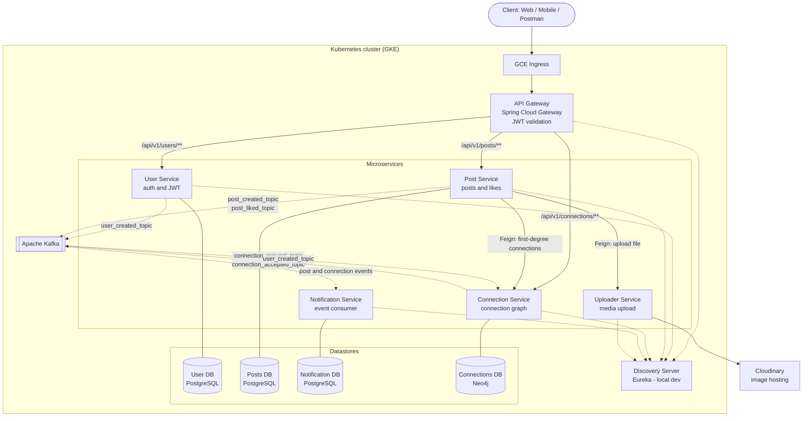
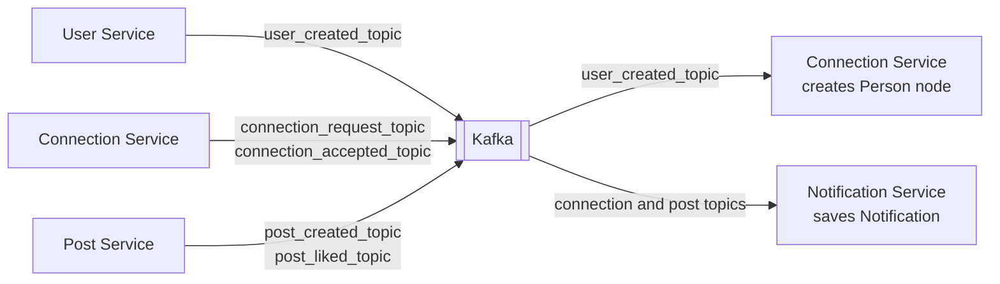
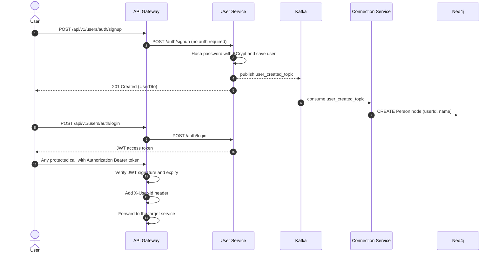
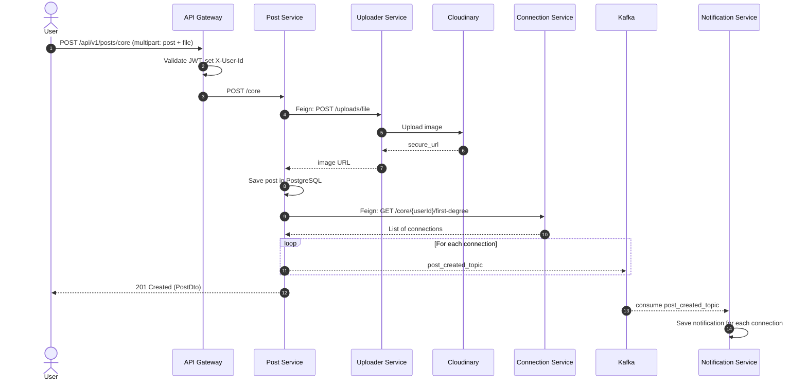
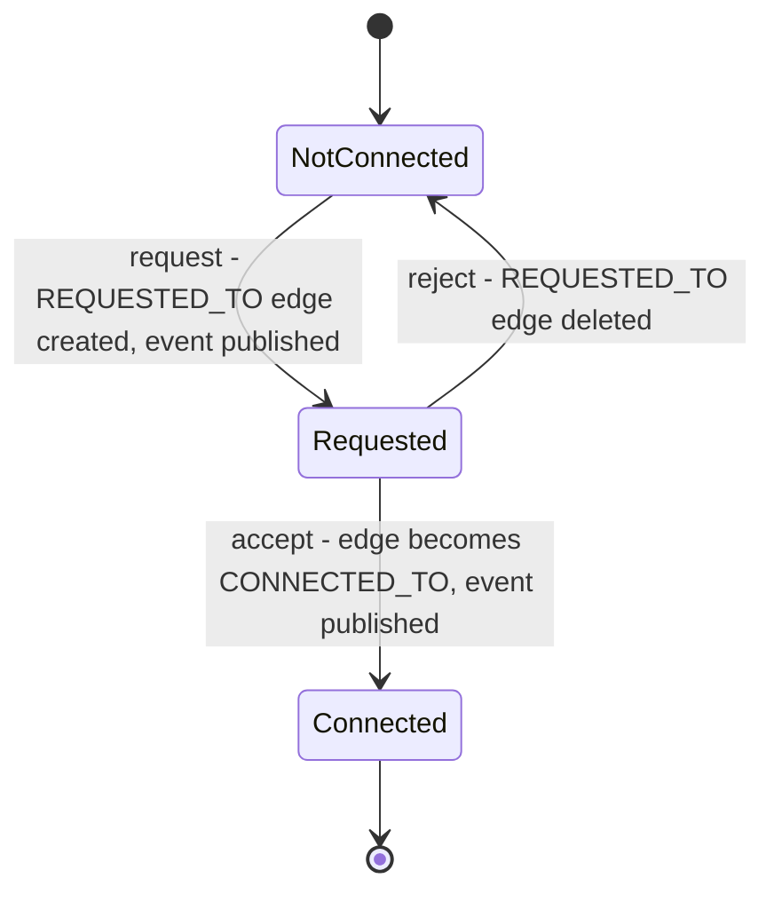
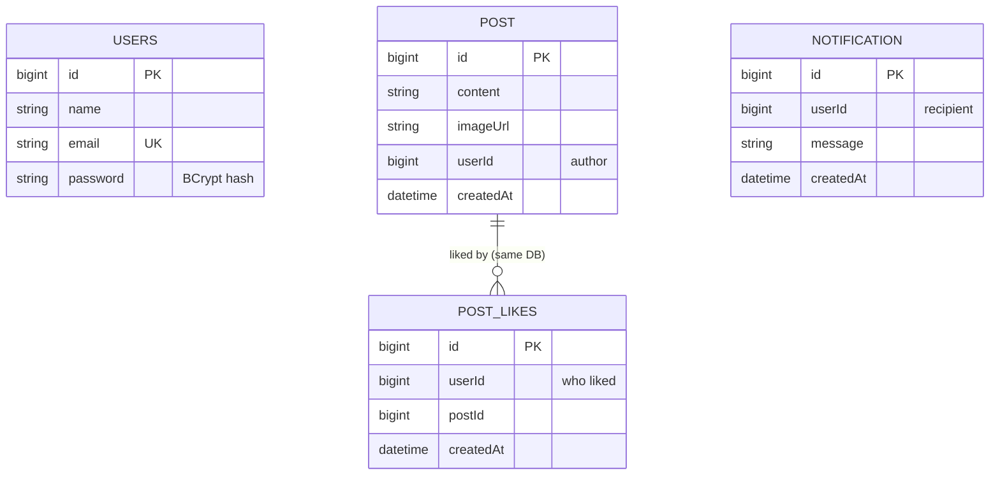
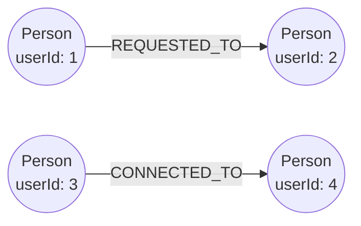
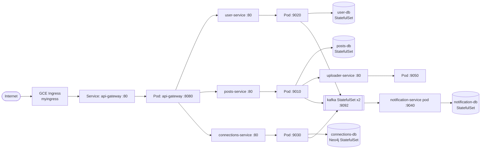

# 🔗 LinkSphere

**A LinkedIn-inspired professional networking platform built as a set of Spring Boot microservices.**


LinkSphere lets users sign up, connect with each other, share posts with images, like posts, and get notified about activity in their network. Each capability lives in its own service with its own database, and services talk to each other through REST (OpenFeign) and Kafka events.

---

## 📑 Table of Contents

- [Features](#-features)
- [Architecture](#-architecture)
- [Services](#-services)
- [Event Flow (Kafka)](#-event-flow-kafka)
- [Key Workflows](#-key-workflows)
- [Data Models](#-data-models)
- [API Reference](#-api-reference)
- [Tech Stack](#-tech-stack)
- [Project Structure](#-project-structure)
- [Getting Started (Local)](#-getting-started-local)
- [Deploying to Kubernetes (GKE)](#-deploying-to-kubernetes-gke)
- [Configuration](#-configuration)
- [Roadmap](#-roadmap)

---

## ✨ Features

- **Authentication** – sign up and log in with BCrypt-hashed passwords and stateless **JWT** access tokens.
- **Centralised security** – the API Gateway validates the JWT once and forwards the caller's identity to downstream services via an `X-User-Id` header.
- **Connections** – send, accept and reject connection requests; fetch your first-degree connections. Stored as a graph in **Neo4j**.
- **Posts** – create posts with an image, fetch a post, list all posts by a user.
- **Likes** – like and unlike posts (duplicate likes are rejected).
- **Media uploads** – images are uploaded to **Cloudinary** through a dedicated uploader service.
- **Notifications** – asynchronous, event-driven notifications for new connection requests, accepted connections, new posts from your connections, and likes on your posts.
- **Cloud-native deployment** – containerised with **Jib**, deployed on **Kubernetes (GKE)** behind a GCE Ingress.

---

## 🏗 Architecture



**Design principles**

- **Database per service** – each service owns its data; no cross-service joins. References between services (for example `userId`) are logical, not foreign keys.
- **Polyglot persistence** – relational data in PostgreSQL, relationship data in Neo4j where graph traversal is the natural fit.
- **Sync where you need an answer, async where you don't** – Feign for request/response calls (upload an image, fetch connections), Kafka for fire-and-forget side effects (notifications, creating a graph node for a new user).
- **Gateway-level authentication** – downstream services trust the `X-User-Id` header injected by the gateway and never parse JWTs themselves.
- **Environment-aware config** – the default profile uses Eureka for service discovery (local dev); the `k8s` profile disables Eureka and relies on Kubernetes DNS and Services.

---

## 🧩 Services

| Service | Folder | Port | Datastore | Responsibility |
|---|---|---|---|---|
| **API Gateway** | `APIGateway` | `8080` | – | Single entry point, routing, JWT validation, `X-User-Id` injection |
| **Discovery Server** | `DiscoveryServer` | `8761` | – | Eureka service registry (local development) |
| **User Service** | `User-Service` | `9020` | PostgreSQL | Sign-up, login, password hashing, JWT issuing; publishes `user_created_topic` |
| **Post Service** | `Post-Service` | `9010` | PostgreSQL | Posts and likes; publishes `post_created_topic` and `post_liked_topic` |
| **Connection Service** | `ConnectionService` | `9030` | Neo4j | Connection requests and first-degree connections; consumes `user_created_topic`; publishes connection events |
| **Notification Service** | `Notification-Service` | `9040` | PostgreSQL | Consumes post and connection events and persists notifications |
| **Uploader Service** | `Uploader-Service` | `9050` | – | Uploads images to Cloudinary and returns the secure URL |

---

## 📨 Event Flow (Kafka)

| Topic | Producer | Consumer | Trigger | Resulting action |
|---|---|---|---|---|
| `user_created_topic` | User Service | Connection Service | A user signs up | Creates a `Person` node in Neo4j |
| `connection_request_topic` | Connection Service | Notification Service | A user sends a connection request | Notifies the receiver |
| `connection_accepted_topic` | Connection Service | Notification Service | A user accepts a request | Notifies the original sender |
| `post_created_topic` | Post Service | Notification Service | A user publishes a post | One event per first-degree connection, each creating a notification |
| `post_liked_topic` | Post Service | Notification Service | A user likes a post | Notifies the post owner |



---

## 🔄 Key Workflows

### 1. Sign-up, login and authenticated requests



### 2. Creating a post (with image and fan-out notifications)



### 3. Connection request lifecycle



Validation rules enforced by the service: you cannot connect with yourself, cannot send a duplicate request, cannot request someone you are already connected to, and can only accept or reject a request that exists.

---

## 🗄 Data Models

### Relational data (PostgreSQL – one database per service)



`USERS` lives in the User Service database, `POST` and `POST_LIKES` in the Post Service database, and `NOTIFICATION` in the Notification Service database. The `userId` columns refer to `USERS.id` logically across service boundaries.

### Graph data (Neo4j – Connection Service)



- Node: `Person { id, userId, name }`
- Relationships: `REQUESTED_TO` (pending request, directed sender → receiver) and `CONNECTED_TO` (accepted; queried as an undirected relationship so both users see each other).

---

## 📡 API Reference

All requests go through the **API Gateway**. The gateway strips the first three path segments (`/api/v1/<service>`) before forwarding.

| Route prefix | Forwarded to | Auth |
|---|---|---|
| `/api/v1/users/**` | User Service | ❌ Public |
| `/api/v1/posts/**` | Post Service | ✅ `Authorization: Bearer <token>` |
| `/api/v1/connections/**` | Connection Service | ✅ `Authorization: Bearer <token>` |

### Users (public)

| Method | Endpoint | Body | Description |
|---|---|---|---|
| `POST` | `/api/v1/users/auth/signup` | `{ "name", "email", "password" }` | Register a user. Returns `201` with the user (no password). |
| `POST` | `/api/v1/users/auth/login` | `{ "email", "password" }` | Returns a JWT access token (valid for 100 minutes). |

### Posts (authenticated)

| Method | Endpoint | Description |
|---|---|---|
| `POST` | `/api/v1/posts/core` | Create a post. `multipart/form-data` with a JSON part `post` (`{"content": "..."}`) and a file part `file`. |
| `GET` | `/api/v1/posts/core/{postId}` | Get a post by id. |
| `GET` | `/api/v1/posts/core/users/{userId}/allPosts` | List all posts by a user. |
| `POST` | `/api/v1/posts/likes/{postId}` | Like a post. `204 No Content`. |
| `POST` | `/api/v1/posts/unlikes/{postId}` | Remove your like. `204 No Content`. |

### Connections (authenticated)

| Method | Endpoint | Description |
|---|---|---|
| `GET` | `/api/v1/connections/core/{userId}/first-degree` | List a user's first-degree connections. |
| `POST` | `/api/v1/connections/core/request/{userId}` | Send a connection request to `userId`. |
| `POST` | `/api/v1/connections/core/accept/{userId}` | Accept the request sent by `userId`. |
| `POST` | `/api/v1/connections/core/reject/{userId}` | Reject the request sent by `userId`. |

### Example session

```bash
BASE=http://<GATEWAY_HOST>   # e.g. http://localhost:8080 locally, or your Ingress IP on GKE

# 1. Sign up
curl -X POST "$BASE/api/v1/users/auth/signup" \
  -H "Content-Type: application/json" \
  -d '{"name":"Ada Lovelace","email":"ada@example.com","password":"s3cret"}'

# 2. Log in and capture the token
TOKEN=$(curl -s -X POST "$BASE/api/v1/users/auth/login" \
  -H "Content-Type: application/json" \
  -d '{"email":"ada@example.com","password":"s3cret"}')

# 3. Send a connection request to user 2
curl -X POST "$BASE/api/v1/connections/core/request/2" \
  -H "Authorization: Bearer $TOKEN"

# 4. Create a post with an image
curl -X POST "$BASE/api/v1/posts/core" \
  -H "Authorization: Bearer $TOKEN" \
  -F 'post={"content":"My first LinkSphere post"};type=application/json' \
  -F "file=@./photo.jpg"

# 5. Like post 1
curl -X POST "$BASE/api/v1/posts/likes/1" \
  -H "Authorization: Bearer $TOKEN"
```

---

## 🛠 Tech Stack

| Layer | Technologies |
|---|---|
| Language / Runtime | Java 21 |
| Framework | Spring Boot (3.x / 4.x), Spring Web MVC, Spring Data JPA, Spring Data Neo4j, Spring Kafka |
| Spring Cloud | Spring Cloud Gateway, Netflix Eureka, OpenFeign |
| Security | JWT (jjwt 0.12.6), BCrypt (jBCrypt) |
| Messaging | Apache Kafka (KRaft mode on Kubernetes) |
| Databases | PostgreSQL 16, Neo4j 4.4 |
| Media | Cloudinary |
| Utilities | Lombok, ModelMapper |
| Build / Images | Maven (wrapper included), Jib |
| Orchestration | Docker, Kubernetes, Google Kubernetes Engine (GKE), GCE Ingress |

---

## 📂 Project Structure

```
LinkSphere/
├── APIGateway/                      # Spring Cloud Gateway + JWT filter
├── DiscoveryServer/DiscoveryServer/ # Eureka server
├── User-Service/User-Service/       # Auth, users, JWT
├── Post-Service/Post-Service/       # Posts, likes
├── ConnectionService/ConnectionService/  # Neo4j connection graph
├── Notification-Service/Notification-Service/  # Kafka consumers + notifications
├── Uploader-Service/Uploader-Service/      # Cloudinary uploads
└── k8s/                             # Kubernetes manifests
    ├── api-gateway.yml
    ├── user-service.yml / user-db.yml
    ├── posts-service.yml / posts-db.yml
    ├── connections-service.yml / connections-db.yml
    ├── notification-service.yml / notification-db.yml
    ├── uploader-service.yml
    ├── kafka.yml
    ├── ingress.yml
    └── post.json                    # sample post payload
```

---

## 🚀 Getting Started (Local)

### Prerequisites

- JDK 21
- Docker (to run the infrastructure containers below)
- A Cloudinary account (free tier is fine)

### 1. Start the infrastructure

```bash
# Kafka (KRaft, no ZooKeeper) on localhost:9092
docker run -d --name ls-kafka -p 9092:9092 apache/kafka:latest

# PostgreSQL on localhost:5432
docker run -d --name ls-postgres -p 5432:5432 \
  -e POSTGRES_PASSWORD=admin123 postgres:16

# Create the three databases the services expect
docker exec -it ls-postgres psql -U postgres \
  -c 'CREATE DATABASE "LS_userDB";' \
  -c 'CREATE DATABASE "LinkSphere";' \
  -c 'CREATE DATABASE "notificationDb";'

# Neo4j on bolt://localhost:7687
docker run -d --name ls-neo4j -p 7474:7474 -p 7687:7687 \
  -e NEO4J_AUTH=neo4j/admin123 neo4j:4.4
```

### 2. Provide your Cloudinary credentials

```bash
export CLOUDINARY_CLOUD_NAME=<your-cloud-name>
export CLOUDINARY_API_KEY=<your-api-key>
export CLOUDINARY_API_SECRET=<your-api-secret>
```

### 3. Start the services (in this order, one terminal each)

```bash
cd DiscoveryServer/DiscoveryServer       && ./mvnw spring-boot:run   # 8761
cd Uploader-Service/Uploader-Service     && ./mvnw spring-boot:run   # 9050
cd User-Service/User-Service             && ./mvnw spring-boot:run   # 9020
cd ConnectionService/ConnectionService   && ./mvnw spring-boot:run   # 9030
cd Post-Service/Post-Service             && ./mvnw spring-boot:run   # 9010
cd Notification-Service/Notification-Service && ./mvnw spring-boot:run # 9040
cd APIGateway                            && ./mvnw spring-boot:run   # 8080
```

Open the Eureka dashboard at <http://localhost:8761> to confirm everything registered, then call the API through the gateway at `http://localhost:8080` (see the [example session](#example-session)).

> **Note:** `mvn package` also runs the Jib plugin, which builds and pushes a Docker image to Docker Hub. Use `./mvnw spring-boot:run`, or add `-Djib.skip=true`, when you only want to build locally.

---

## ☸ Deploying to Kubernetes (GKE)

Container images are built with Jib and published to Docker Hub (`arnavcodes14/linksphere-*`).

### 1. Build and push images

Log in to Docker Hub (or change the `<image>` in each service's `pom.xml`), then in each service folder:

```bash
./mvnw package        # Jib builds and pushes the image during the package phase
```

### 2. Create the Cloudinary secret

```bash
kubectl create secret generic cloudinary-credentials \
  --from-literal=CLOUDINARY_CLOUD_NAME=<your-cloud-name> \
  --from-literal=CLOUDINARY_API_KEY=<your-api-key> \
  --from-literal=CLOUDINARY_API_SECRET=<your-api-secret>
```

### 3. Apply the manifests

```bash
for f in k8s/*.yml; do kubectl apply -f "$f"; done
```

This creates the Kafka StatefulSet (2 replicas), the PostgreSQL and Neo4j StatefulSets with persistent volumes, all service Deployments and ClusterIP Services, and a GCE Ingress that routes all traffic to the API Gateway.

### 4. Find the public address

```bash
kubectl get ingress myingress
```

Use the ingress IP as `BASE` in the [example session](#example-session). The gateway has a long readiness delay (`initialDelaySeconds: 300`), so give it a few minutes on first start.



---

## ⚙ Configuration

Each service ships with a default profile for local development and a `k8s` profile for the cluster (activated with `SPRING_PROFILES_ACTIVE=k8s`).

| Variable | Used by | Purpose |
|---|---|---|
| `SPRING_PROFILES_ACTIVE` | all services | Set to `k8s` in the cluster |
| `DB_SERVER`, `DB_NAME`, `DB_USERNAME`, `DB_PASSWORD` | User, Post, Notification, Connection (k8s profile) | Database connection |
| `UPLOADER_SERVICE_URI` | Post Service | Base URL of the Uploader Service |
| `CONNECTIONS_SERVICE_URI` | Post Service, API Gateway | Base URL of the Connection Service |
| `USER_SERVICE_URI`, `POSTS_SERVICE_URI` | API Gateway | Downstream route targets (override Eureka lookup) |
| `CLOUDINARY_CLOUD_NAME`, `CLOUDINARY_API_KEY`, `CLOUDINARY_API_SECRET` | Uploader Service | Cloudinary credentials |
| `jwt.secretKey` | API Gateway, User Service | HMAC key used to sign and verify JWTs. **Must be identical in both.** |

> ⚠️ **Never commit real credentials.** Supply secrets through environment variables or Kubernetes Secrets, and change the sample passwords in the manifests before running anywhere public.

---

## 🗺 Roadmap

- [ ] REST endpoints to read and mark notifications as read (notifications are currently stored but not exposed)
- [ ] Comments on posts, with notifications to the post owner
- [ ] Refresh tokens and role-based authorization
- [ ] Move secrets (JWT key, DB credentials) fully into Kubernetes Secrets
- [ ] Feed / timeline built from first-degree connections' posts
- [ ] Second-degree connection suggestions using Neo4j traversal
- [ ] CI/CD pipeline (build, test, push images, deploy to GKE)
- [ ] Centralised logging, metrics and distributed tracing
- [ ] Web or mobile frontend

---

## 👤 Author

**TheProfessorcodes** — [GitHub](https://github.com/TheProfessorcodes)

If you find this project useful, consider giving it a ⭐.
