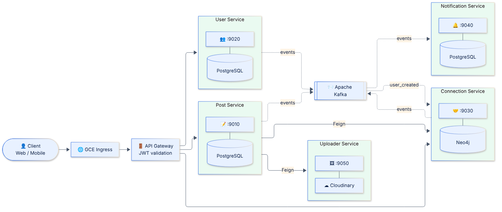
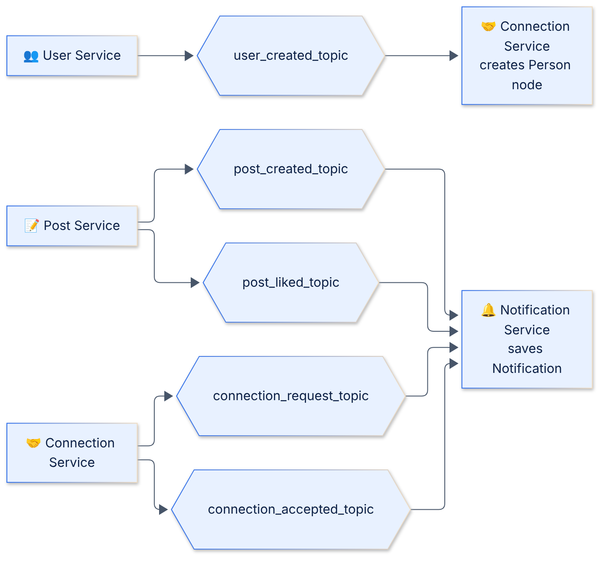
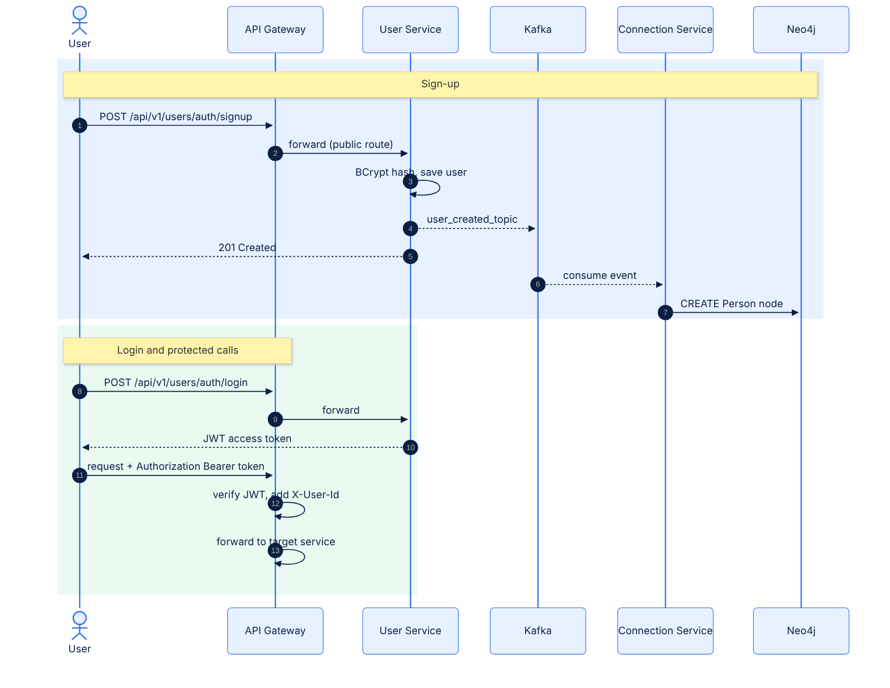
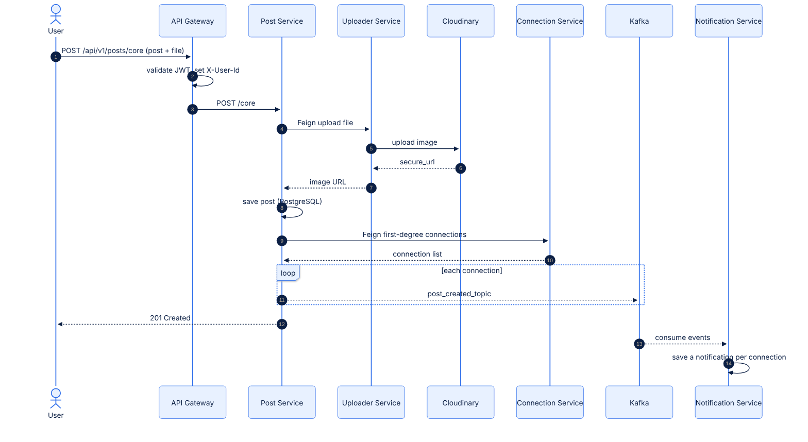
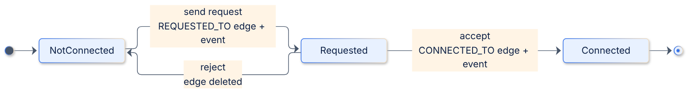
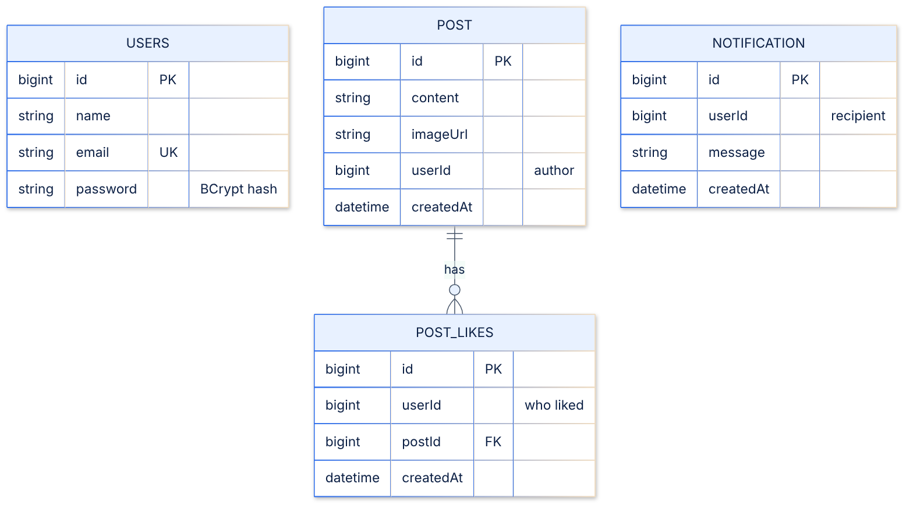
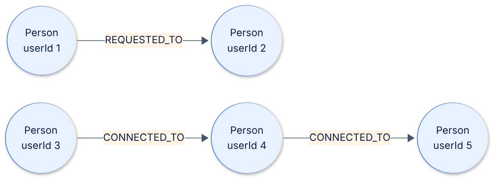
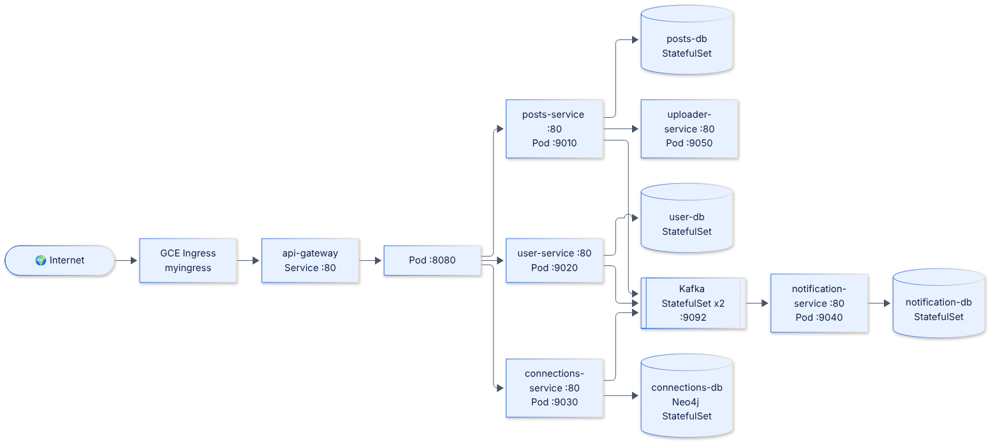

# 🌐 LinkSphere

**A LinkedIn-inspired professional networking platform built with Spring Boot microservices, Kafka, PostgreSQL, Neo4j, Docker and Kubernetes (GKE).**


<details>
<summary><b>🧭 Explore this README</b></summary>

<br>

| Section | What you'll find |
| :--- | :--- |
| [✨ Features](#features) | What LinkSphere can do |
| [📐 Architecture](#architecture) | System design diagrams, Kafka events, data models |
| [🧩 Services](#services) | The 7 microservices, their ports and databases |
| [📡 API](#api) | Endpoints and an example curl session |
| [🛠 Tech Stack](#tech-stack) | Languages, frameworks and tools used |
| [🚀 Run Locally](#run-locally) | Set up and start the project on your machine |
| [☸ Deploy](#deploy) | Deploy to Kubernetes (GKE) |
| [🗺 Roadmap](#roadmap) | Planned improvements |

</details>

---

LinkSphere lets users **sign up, connect with each other, share image posts, like posts, and get notified** about activity in their network. Every capability lives in its own service with its own database. Services talk over **REST (OpenFeign)** when they need an answer and over **Kafka events** when they don't.

<a name="features"></a>
## ✨ Features

* **🔐 Authentication:** Sign up and log in with BCrypt-hashed passwords and stateless **JWT** access tokens.
* **🚪 Gateway-level security:** The API Gateway validates the JWT once and forwards the caller's identity downstream in an `X-User-Id` header.
* **🤝 Connections:** Send, accept and reject connection requests and list first-degree connections, stored as a graph in **Neo4j**.
* **📝 Posts & Likes:** Create posts with an image, fetch a post, list a user's posts, like and unlike (duplicate likes are rejected).
* **🖼 Media uploads:** Images go through a dedicated uploader service to **Cloudinary**.
* **🔔 Notifications:** Event-driven notifications for new connection requests, accepted connections, new posts from your connections and likes on your posts.
* **☸ Cloud-native:** Containerised with **Jib** and deployed on **Kubernetes (GKE)** behind a GCE Ingress.

---

<a name="architecture"></a>
## 📐 System Design & Architecture

LinkSphere follows a **database-per-service** design. Click any diagram to view it full size.

### 1. 🏢 High-Level Architecture
All traffic enters through the Ingress and the API Gateway, which routes to the User, Post and Connection services. Post Service calls Connection and Uploader synchronously with Feign, while every service publishes or consumes Kafka events asynchronously.

[](./assets/architecture.png)

### 2. 📨 Event Flow (Kafka)
Five topics connect the services. Producers never wait for consumers, so a slow or failing notification never blocks a post, like or connection request.

[](./assets/kafka-events.png)

| Topic | Producer | Consumer | Result |
| :--- | :--- | :--- | :--- |
| `user_created_topic` | User Service | Connection Service | Creates a `Person` node in Neo4j |
| `connection_request_topic` | Connection Service | Notification Service | Notifies the receiver |
| `connection_accepted_topic` | Connection Service | Notification Service | Notifies the original sender |
| `post_created_topic` | Post Service | Notification Service | One event per first-degree connection, each saved as a notification |
| `post_liked_topic` | Post Service | Notification Service | Notifies the post owner |

### 3. 🔐 Sign-up, Login & Authenticated Requests
Signing up saves the user and fires `user_created_topic`, so the Connection Service creates the matching graph node. After login, every protected request carries the JWT. The gateway verifies it and injects `X-User-Id`; downstream services never parse tokens themselves.

[](./assets/auth-flow.png)

### 4. 📝 Creating a Post (Image Upload + Fan-out)
The Post Service uploads the image through the Uploader, saves the post, asks the Connection Service for the author's connections, then publishes one `post_created_topic` event per connection.

[](./assets/create-post-flow.png)

### 5. 🤝 Connection Request Lifecycle
Backed by two Neo4j relationship types, `REQUESTED_TO` and `CONNECTED_TO`. You cannot connect with yourself, send a duplicate request, request someone you're already connected to, or accept/reject a request that doesn't exist.

[](./assets/connection-lifecycle.png)

### 6. 🗄 Data Models

<table>
<tr>
<td width="50%" valign="top">

**📊 Relational (PostgreSQL)**

`USERS` lives in the User DB, `POST` and `POST_LIKES` in the Posts DB, `NOTIFICATION` in the Notification DB. `userId` columns reference `USERS.id` logically across services (no cross-database foreign keys).

[](./assets/erd.png)

</td>
<td width="50%" valign="top">

**🕸 Graph (Neo4j)**

Node `Person { id, userId, name }`. `REQUESTED_TO` is a pending request (sender → receiver); `CONNECTED_TO` is queried undirected so both users see each other.

[](./assets/graph-model.png)

</td>
</tr>
</table>

### 7. ☸ Kubernetes Deployment
Everything runs on GKE: one Deployment + ClusterIP Service per microservice, StatefulSets with persistent volumes for the databases, a 2-replica Kafka StatefulSet (KRaft), and a GCE Ingress in front of the gateway.

[](./assets/k8s-deployment.png)

### 🧠 Design Principles
* **Database per service:** No cross-service joins; references like `userId` are logical.
* **Polyglot persistence:** PostgreSQL for relational data, Neo4j where graph traversal is the natural fit.
* **Sync where you need an answer, async where you don't:** Feign for upload and connection lookups, Kafka for notifications and graph-node creation.
* **Authenticate once, at the edge:** Downstream services trust the gateway's `X-User-Id` header.
* **Environment-aware config:** The default profile uses Eureka (local dev); the `k8s` profile disables it and uses Kubernetes DNS.

---

<a name="services"></a>
## 🧩 Services

| Service | Folder | Port | Datastore | Responsibility |
| :--- | :--- | :---: | :--- | :--- |
| 🚪 **API Gateway** | `APIGateway` | `8080` | – | Routing, JWT validation, `X-User-Id` injection |
| 🧭 **Discovery Server** | `DiscoveryServer` | `8761` | – | Eureka registry (local development) |
| 👥 **User Service** | `User-Service` | `9020` | PostgreSQL | Sign-up, login, BCrypt, JWT issuing |
| 📝 **Post Service** | `Post-Service` | `9010` | PostgreSQL | Posts and likes |
| 🤝 **Connection Service** | `ConnectionService` | `9030` | Neo4j | Connection requests, first-degree connections |
| 🔔 **Notification Service** | `Notification-Service` | `9040` | PostgreSQL | Consumes events, stores notifications |
| 🖼 **Uploader Service** | `Uploader-Service` | `9050` | – | Uploads images to Cloudinary |

---

<a name="api"></a>
## 📡 API Reference

Every call goes through the **API Gateway**, which strips the first three path segments (`/api/v1/<service>`) before forwarding.

| Route prefix | Forwarded to | Auth |
| :--- | :--- | :--- |
| `/api/v1/users/**` | User Service | ❌ Public |
| `/api/v1/posts/**` | Post Service | ✅ `Authorization: Bearer <token>` |
| `/api/v1/connections/**` | Connection Service | ✅ `Authorization: Bearer <token>` |

<details>
<summary><b>👥 Users (public)</b></summary>

| Method | Endpoint | Body | Description |
| :--- | :--- | :--- | :--- |
| `POST` | `/api/v1/users/auth/signup` | `{ "name", "email", "password" }` | Register. Returns `201` with the user (no password). |
| `POST` | `/api/v1/users/auth/login` | `{ "email", "password" }` | Returns a JWT access token (valid 100 minutes). |

</details>

<details>
<summary><b>📝 Posts & Likes (authenticated)</b></summary>

| Method | Endpoint | Description |
| :--- | :--- | :--- |
| `POST` | `/api/v1/posts/core` | Create a post. `multipart/form-data`: JSON part `post` (`{"content": "..."}`) and file part `file`. |
| `GET` | `/api/v1/posts/core/{postId}` | Get a post by id. |
| `GET` | `/api/v1/posts/core/users/{userId}/allPosts` | List all posts by a user. |
| `POST` | `/api/v1/posts/likes/{postId}` | Like a post (`204`). |
| `POST` | `/api/v1/posts/unlikes/{postId}` | Remove your like (`204`). |

</details>

<details>
<summary><b>🤝 Connections (authenticated)</b></summary>

| Method | Endpoint | Description |
| :--- | :--- | :--- |
| `GET` | `/api/v1/connections/core/{userId}/first-degree` | List a user's first-degree connections. |
| `POST` | `/api/v1/connections/core/request/{userId}` | Send a connection request to `userId`. |
| `POST` | `/api/v1/connections/core/accept/{userId}` | Accept the request sent by `userId`. |
| `POST` | `/api/v1/connections/core/reject/{userId}` | Reject the request sent by `userId`. |

</details>

<details>
<summary><b>⚡ Try it: example curl session</b></summary>

```bash
BASE=http://localhost:8080   # or your Ingress IP on GKE

# 1. Sign up
curl -X POST "$BASE/api/v1/users/auth/signup" \
  -H "Content-Type: application/json" \
  -d '{"name":"Ada Lovelace","email":"ada@example.com","password":"s3cret"}'

# 2. Log in and capture the token
TOKEN=$(curl -s -X POST "$BASE/api/v1/users/auth/login" \
  -H "Content-Type: application/json" \
  -d '{"email":"ada@example.com","password":"s3cret"}')

# 3. Send a connection request to user 2
curl -X POST "$BASE/api/v1/connections/core/request/2" \
  -H "Authorization: Bearer $TOKEN"

# 4. Create a post with an image
curl -X POST "$BASE/api/v1/posts/core" \
  -H "Authorization: Bearer $TOKEN" \
  -F 'post={"content":"My first LinkSphere post"};type=application/json' \
  -F "file=@./photo.jpg"

# 5. Like post 1
curl -X POST "$BASE/api/v1/posts/likes/1" \
  -H "Authorization: Bearer $TOKEN"
```

</details>

---

<a name="tech-stack"></a>
## 🛠 Tech Stack

| Category | Technology | Purpose / Use Case |
| :--- | :--- | :--- |
| **Language** |  | Core application logic |
| **Framework** |  | Web MVC, Data JPA, Data Neo4j, Kafka integration |
| **API Gateway** |  | Routing and JWT filter |
| **Service Discovery** |  | Service registry for local development |
| **Inter-service calls** |  | Declarative REST clients |
| **Security** |  | Stateless authentication (BCrypt for passwords) |
| **Messaging** |  | Asynchronous domain events (KRaft mode on Kubernetes) |
| **Relational DB** |  | Users, posts, likes, notifications |
| **Graph DB** |  | Connection graph |
| **Media** |  | Image hosting |
| **Utilities** |  | Lombok, ModelMapper |
| **Build & Images** |   | Maven wrapper builds, daemonless container images |
| **Orchestration** |   | Containers on GKE with a GCE Ingress |

---

<details>
<summary><b>📂 Project Structure</b></summary>

```
LinkSphere/
├── APIGateway/                                  # Spring Cloud Gateway + JWT filter
├── DiscoveryServer/DiscoveryServer/             # Eureka server
├── User-Service/User-Service/                   # Auth, users, JWT
├── Post-Service/Post-Service/                   # Posts, likes
├── ConnectionService/ConnectionService/         # Neo4j connection graph
├── Notification-Service/Notification-Service/   # Kafka consumers + notifications
├── Uploader-Service/Uploader-Service/           # Cloudinary uploads
├── k8s/                                         # Kubernetes manifests
│   ├── api-gateway.yml
│   ├── user-service.yml        user-db.yml
│   ├── posts-service.yml       posts-db.yml
│   ├── connections-service.yml connections-db.yml
│   ├── notification-service.yml notification-db.yml
│   ├── uploader-service.yml
│   ├── kafka.yml
│   └── ingress.yml
└── assets/                                      # README diagrams
```

</details>

---

<a name="run-locally"></a>
## 🚀 Run Locally

**Prerequisites:** JDK 21, Docker, and a free [Cloudinary](https://cloudinary.com) account.

<details>
<summary><b>1️⃣ Start the infrastructure (Kafka, PostgreSQL, Neo4j)</b></summary>

```bash
# Kafka (KRaft, no ZooKeeper) on localhost:9092
docker run -d --name ls-kafka -p 9092:9092 apache/kafka:latest

# PostgreSQL on localhost:5432
docker run -d --name ls-postgres -p 5432:5432 \
  -e POSTGRES_PASSWORD=<choose-a-password> postgres:16

# Create the three databases the services expect
docker exec -it ls-postgres psql -U postgres \
  -c 'CREATE DATABASE "LS_userDB";' \
  -c 'CREATE DATABASE "LinkSphere";' \
  -c 'CREATE DATABASE "notificationDb";'

# Neo4j on bolt://localhost:7687
docker run -d --name ls-neo4j -p 7474:7474 -p 7687:7687 \
  -e NEO4J_AUTH=neo4j/<choose-a-password> neo4j:4.4
```

</details>

<details>
<summary><b>2️⃣ Set your environment variables</b></summary>

```bash
export DB_USERNAME=postgres
export DB_PASSWORD=<your-postgres-password>
export NEO4J_PASSWORD=<your-neo4j-password>
export JWT_SECRET_KEY=<random-string-of-at-least-32-characters>
export CLOUDINARY_CLOUD_NAME=<your-cloud-name>
export CLOUDINARY_API_KEY=<your-api-key>
export CLOUDINARY_API_SECRET=<your-api-secret>
```

> `JWT_SECRET_KEY` must be the **same value** for the API Gateway and the User Service.

</details>

<details>
<summary><b>3️⃣ Start the services (one terminal each, in this order)</b></summary>

```bash
cd DiscoveryServer/DiscoveryServer           && ./mvnw spring-boot:run   # 8761
cd Uploader-Service/Uploader-Service         && ./mvnw spring-boot:run   # 9050
cd User-Service/User-Service                 && ./mvnw spring-boot:run   # 9020
cd ConnectionService/ConnectionService       && ./mvnw spring-boot:run   # 9030
cd Post-Service/Post-Service                 && ./mvnw spring-boot:run   # 9010
cd Notification-Service/Notification-Service && ./mvnw spring-boot:run   # 9040
cd APIGateway                                && ./mvnw spring-boot:run   # 8080
```

Open <http://localhost:8761> to confirm every service registered, then call the API through the gateway at `http://localhost:8080`.

> **Heads-up:** `mvn package` also runs the Jib plugin, which builds **and pushes** a Docker image. Use `./mvnw spring-boot:run`, or add `-Djib.skip=true`, to build locally only.

</details>

---

<a name="deploy"></a>
## ☸ Deploy to Kubernetes (GKE)

<details>
<summary><b>Step-by-step deployment</b></summary>

**1. Build and push images** (Jib publishes to Docker Hub as `arnavcodes14/linksphere-*`; change the `<image>` in each `pom.xml` to use your own registry):

```bash
./mvnw package      # run inside each service folder
```

**2. Create the secrets**

```bash
kubectl create secret generic cloudinary-credentials \
  --from-literal=CLOUDINARY_CLOUD_NAME=<your-cloud-name> \
  --from-literal=CLOUDINARY_API_KEY=<your-api-key> \
  --from-literal=CLOUDINARY_API_SECRET=<your-api-secret>

kubectl create secret generic linksphere-secrets \
  --from-literal=JWT_SECRET_KEY=<random-string-of-at-least-32-characters> \
  --from-literal=DB_PASSWORD=<your-db-password> \
  --from-literal=NEO4J_PASSWORD=<your-neo4j-password>
```

**3. Apply the manifests**

```bash
for f in k8s/*.yml; do kubectl apply -f "$f"; done
```

**4. Find the public address**

```bash
kubectl get ingress myingress
```

Use the ingress IP as `BASE` in the curl example. The gateway has a long readiness delay (`initialDelaySeconds: 300`), so allow a few minutes on first start.

</details>

---

<details>
<summary><b>⚙ Configuration reference</b></summary>

Each service has a default profile for local development and a `k8s` profile (`SPRING_PROFILES_ACTIVE=k8s`) for the cluster.

| Variable | Used by | Purpose |
| :--- | :--- | :--- |
| `SPRING_PROFILES_ACTIVE` | all services | Set to `k8s` in the cluster |
| `DB_SERVER`, `DB_NAME`, `DB_USERNAME`, `DB_PASSWORD` | User, Post, Notification, Connection (k8s profile) | Database connection |
| `NEO4J_PASSWORD` | Connection Service (local) | Neo4j password |
| `UPLOADER_SERVICE_URI` | Post Service | Base URL of the Uploader Service |
| `CONNECTIONS_SERVICE_URI` | Post Service, API Gateway | Base URL of the Connection Service |
| `USER_SERVICE_URI`, `POSTS_SERVICE_URI` | API Gateway | Downstream route targets (override Eureka lookup) |
| `CLOUDINARY_CLOUD_NAME`, `CLOUDINARY_API_KEY`, `CLOUDINARY_API_SECRET` | Uploader Service | Cloudinary credentials |
| `JWT_SECRET_KEY` | API Gateway, User Service | HMAC key to sign and verify JWTs. **Must match in both.** |

> ⚠️ Never commit real credentials. Supply secrets through environment variables or Kubernetes Secrets.

</details>

---

<a name="roadmap"></a>
## 🗺 Roadmap

- [ ] REST endpoints to read and mark notifications as read (they're stored but not yet exposed)
- [ ] Comments on posts, with notifications to the post owner
- [ ] Refresh tokens and role-based authorization
- [ ] Feed / timeline built from first-degree connections' posts
- [ ] Second-degree connection suggestions using Neo4j traversal
- [ ] CI/CD pipeline (build, test, push images, deploy to GKE)
- [ ] Centralised logging, metrics and distributed tracing
- [ ] Web or mobile frontend

---

## 👤 Author

**TheProfessorcodes** · [GitHub](https://github.com/TheProfessorcodes)

If you find this project useful, consider giving it a ⭐ and feel free to open an issue or reach out.
